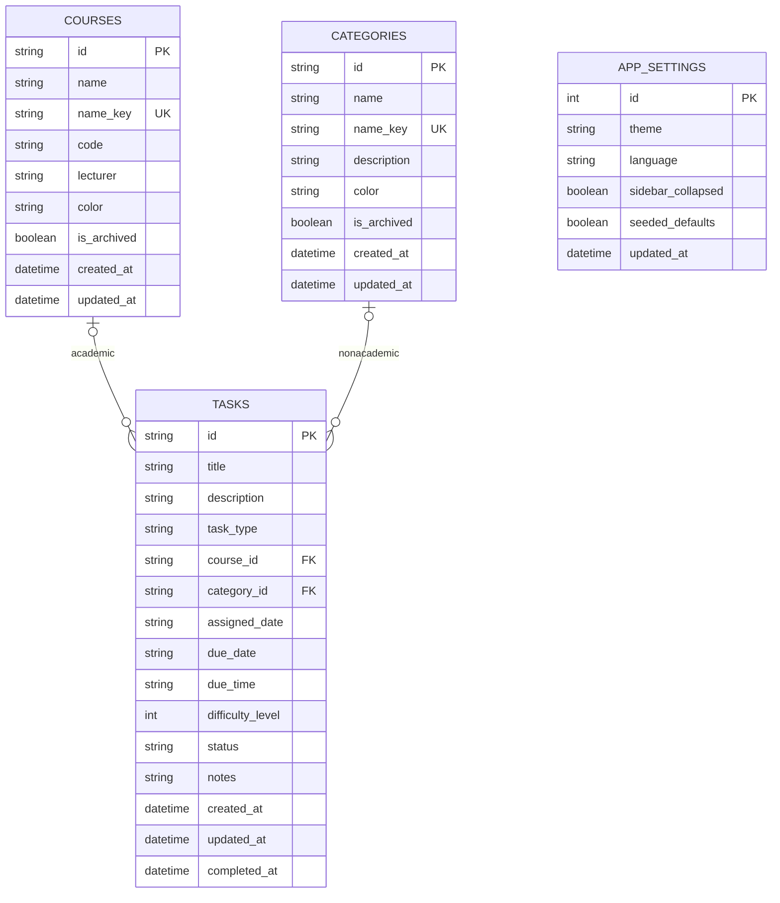

# Database specification
SQLite local file `data/priorio.db`, Prisma ORM 7, migration SQL checked in. All naming snake_case in DB, camelCase service DTO allowed with explicit mapping. IDs UUID strings generated server-side; timestamps UTC ISO instant (Prisma DateTime). Local calendar dates and wall-clock times stored TEXT to avoid UTC conversion. All mutations use server validation and parameterized access.

Exactly one matching group for each task (XOR); ERD optional links individually. Settings singleton independent.

## Columns
| Table | Column | Type / nullability | Constraint/default |
|---|---|---|---|
| courses | id | TEXT not null | PK UUID |
| courses | name, name_key | TEXT not null | trimmed 1–100; normalized key unique |
| courses | code, lecturer | TEXT nullable | <=30, <=100 |
| courses | color | TEXT not null | #RRGGBB; default #6366F1 |
| courses | is_archived | BOOLEAN not null | false |
| courses | created_at, updated_at | DATETIME not null | UTC |
| categories | id | TEXT not null | PK UUID |
| categories | name, name_key | TEXT not null | trimmed 1–100; key unique |
| categories | description | TEXT nullable | <=500 |
| categories | color | TEXT not null | #RRGGBB; default #64748B |
| categories | is_archived | BOOLEAN not null | false |
| categories | created_at, updated_at | DATETIME not null | UTC |
| tasks | id | TEXT not null | PK UUID |
| tasks | title | TEXT not null | trimmed 1–150 |
| tasks | description, notes | TEXT nullable | <=5000, <=2000 |
| tasks | task_type | TEXT not null | ACADEMIC / NONACADEMIC |
| tasks | course_id, category_id | TEXT nullable | FK restrict, XOR |
| tasks | assigned_date, due_date | TEXT not null | YYYY-MM-DD, actual valid date, due>=assigned |
| tasks | due_time | TEXT nullable | HH:mm 24h; null=end of day |
| tasks | difficulty_level | INTEGER not null | 0..5 default 0 |
| tasks | status | TEXT not null | TODO/IN_PROGRESS/COMPLETED; default TODO |
| tasks | created_at, updated_at | DATETIME not null | UTC |
| tasks | completed_at | DATETIME nullable | required iff COMPLETED |
| app_settings | id | INTEGER not null | PK check id=1 |
| app_settings | theme | TEXT not null | light/dark default light |
| app_settings | language | TEXT not null | id/en default id |
| app_settings | sidebar_collapsed | BOOLEAN not null | false |
| app_settings | seeded_defaults | BOOLEAN not null | false |
| app_settings | updated_at | DATETIME not null | UTC |

## Integrity
Prisma schema plus custom SQL migration CHECKs (Prisma schema alone may not express all checks). Require FK enforcement at runtime and test `PRAGMA foreign_keys=ON`. onDelete Restrict; onUpdate Restrict or no action (IDs immutable). SQL CHECK task_type enum and exact XOR matching type; status enum; completed_at iff completed; typeof(level)='integer' and between 0 and 5; dates shape and lexical due>=assigned; time shape/range; title/name trimmed nonempty and length limits; boolean domains; settings theme/language/singleton. Actual calendar validity, Unicode normalization and all lengths enforced with Zod/service, never rely solely on SQL. Check custom constraints after migration/table rebuild. Name uniqueness database index on name_key; normalization NFKC -> trim -> collapse whitespace -> lowercase, stored and display name trimmed. Catch unique/FK races and map to domain errors. Archived reference guard in service transaction, existing archived group may remain on task edit, not assigned to new tasks or changed to another archived group. Delete only if zero tasks (all statuses), no cascade.

Indexes: tasks(status,due_date,due_time), tasks(course_id), tasks(category_id), tasks(completed_at), tasks(created_at); group name_key unique; optional archived indexes only if justified. No persistent priority, overdue, task count or progress columns. Search title/description with normalized application comparison for <=5000 rows; do not use case-sensitive SQLite LIKE as Unicode search guarantee. Stable sort as PRD.

## Init/migration
`npm run db:generate`, `npm run db:migrate` (deploy, never reset), `npm run db:seed`. Seed in transaction: upsert settings id=1, if seeded_defaults=false insert default categories only if normalized name absent and then set flag. Never restore deliberately deleted categories on rerun. No courses/tasks seeded in production. Development migration creation uses `npm run db:migrate:dev -- --name <name>` only on disposable dev DB. Never on user DB. Keep migration SQL checked in, backup before upgrade, test empty -> latest and existing fixture upgrade. Test data isolated in OS temp directory. Resolve DATABASE_URL relative to project root in same helper for CLI/runtime; create parent directory before migration; normalize Windows paths; reject paths under public; no accidental second DB file.

## Backup
See SECURITY. Stop server before filesystem backup, verify no other writer; include WAL/SHM if present as a consistent stopped snapshot or checkpoint before copying. Test restore into temp path and run integrity_check + record count.
